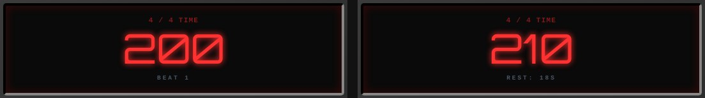

# 吉他健身房 HIIT METRONOME

**像間歇訓練一樣練琴：一組一組加速，練完就休息。**

給吉他與樂器練習用的線上節拍器。設定起始速度、目標速度和休息時間，節拍器會幫你一段段往上推，到點自動喊休息，休息完再接著練。

**[▶ 開啟節拍器](https://bbcode1111.github.io/hiitmetronome/)**

免安裝 · 免登入 · 打開瀏覽器就能練

## 為什麼叫 HIIT

HIIT（高強度間歇訓練）的做法是「全力一組 → 短暫休息 → 再來一組」。練琴也一樣：一直用同一個速度重複，很快就疲乏；每隔幾小節提高一點速度、定時讓手休息，比較能一步步把速度推上去，也不容易越練越僵。

吉他健身房 HIIT METRONOME 就是把這套流程交給節拍器：你只要決定課表，按下 START 專心彈。

## 三步開始

1. **設定起點**：在 **Tempo** 調整起始速度，在 **Time Signature** 設定拍號。
2. **排好課表**：打開 **Interval Training Engine** 設定加速方式；打開 **Rest Logic Control** 設定休息。只想用固定速度練習時，把兩個開關關掉即可。
3. **按 START**：跟著語音預備拍進入，節拍器會自己加速、休息、再開始。隨時按 **STOP** 停止。

## 排一份 HIIT 課表

例如從 **120 BPM 練到 160 BPM**：每 **8 小節**加快 **5 BPM**，每加速 **4 次**休息 **20 秒**，休息後用新的速度接著練。

  

| 面板設定 | 意思 |
| --- | --- |
| **Each (MSR)** | 每練幾小節加速一次（一組的長度）。 |
| **Incr (BPM)** | 每次加快多少 BPM。 |
| **Target BPM** | 想練到的目標速度；到達後維持這個速度，不再加速。 |
| **Every … Increments** | 每加速幾次就休息一次。 |
| **Wait … Sec** | 每次休息幾秒。 |

## 練習中、休息中，一眼看懂

練習時，螢幕顯示目前速度與正在第幾拍，PULSE 燈跟著拍點閃。進入休息時會聽到「Rest」，螢幕倒數剩下的秒數，並直接顯示下一組的速度，讓你休息時就知道接下來要多快。

  

下方狀態列會顯示目前小節（MSR）、已加速次數（INCR）與狀態：RUNNING、CUEING（預備拍）、RESTING 或 STOPPED。

## 用預備拍接上節奏

- **START CUE**：開始練習與休息結束時，先播放一小節語音預備拍。
- **TRANS CUE**：每次加速後，用新速度報數一小節，幫你接上下一段。

報數與休息提示使用同一款 Maeve 女聲，會配合目前的拍號與速度，對齊每個拍點。常用 1–10 報數的各種長度已事先做好，速度很快時也維持原本音高。

## 自由拍號

三拍、五拍、七拍都可以。**Beats / MSR** 直接輸入每小節拍數（正整數），**Note Value** 選 `/4` 或 `/8`。下圖示範 7/8。

  

BPM 以四分音符計算，所以同樣的 BPM 下，選 `/8` 時的拍點間隔是 `/4` 的一半。

## 挑一個彈琴時也聽得到的拍點

在 **Tone** 有六種音色，播放中也能切換：

- **Punchy attack**：Rimshot（預設）、Woodblock、Clave，起音清脆，樂器音量大時比較容易聽清楚。
- **Classic**：Electronic、Mechanical、Cowbell。

**Master Volume** 同時控制拍點和語音，從靜音到 100% 都可以細調。音色都是本專案原創合成，沒有使用品牌採樣。

> 練習時請讓頁面保持在前景、螢幕保持開啟。速度很快或每小節拍數很多時，語音報數會變得比較緊湊。

---

**[開始練習 →](https://bbcode1111.github.io/hiitmetronome/)** · [素材與授權](THIRD_PARTY_NOTICES.md) · powered by BBCODE1111
